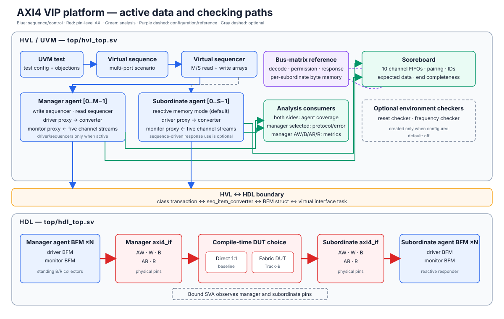
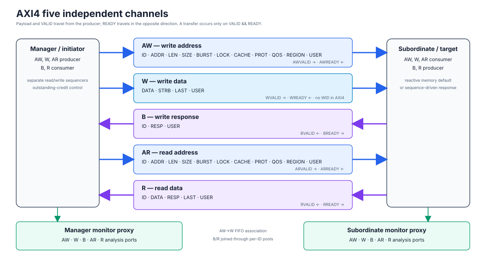
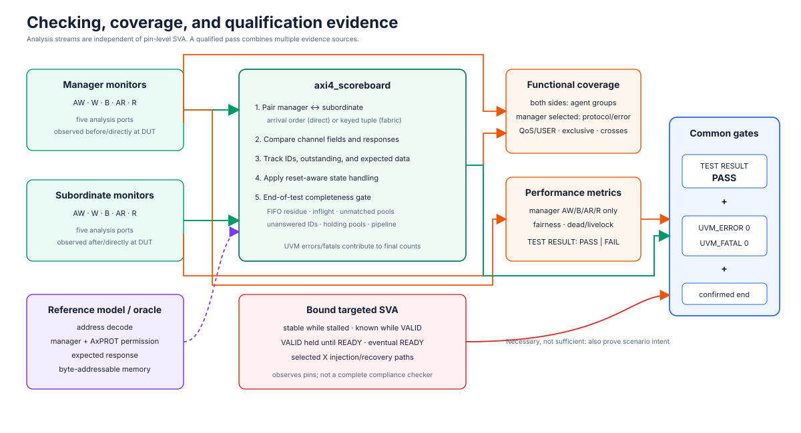
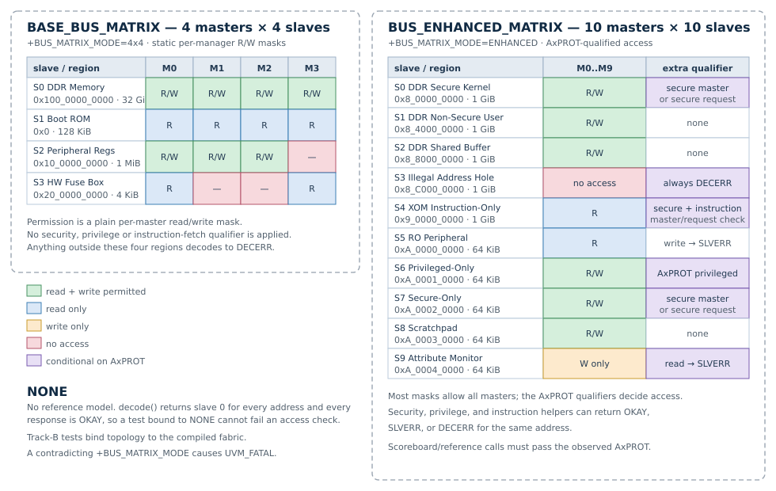
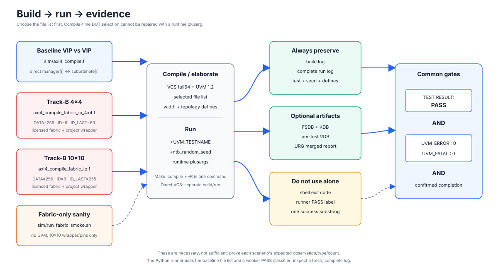

# tim_axi4_vip — AXI4 UVM Verification IP

Native SystemVerilog/UVM 1.2 verification IP for exercising, monitoring, and
checking AMBA AXI4 traffic with configurable manager/subordinate agents, a
reference address map, scoreboarding, assertions, functional coverage, and an
optional commercial-fabric DUT path.



> [!IMPORTANT]
> **Evidence scope.** This document describes the current working tree as
> inspected on **2026-08-13**, with an update on **2026-09-18** covering the
> BENCH-065/BENCH-066 fixes described in
> [Recent verification updates](#recent-verification-updates-2026-09-18) — that
> section's citations were re-read on the later date; the rest of the document
> was not re-verified then. Source paths are repository-relative. A listed
> component or registered test is not, by itself, a claim that every scenario
> has passed a current regression or that this VIP is a certified AXI4
> compliance product.

> [!CAUTION]
> **Licensed-IP boundary.** Commercial fabric RTL under `ext/` is local-only.
> Never commit, push, archive, paste, or upload it—or simulator products derived
> from it (`csrc*`, `simv*`, `*.daidir`)—to any external service. Project-authored
> wrappers and file lists may reference `ext/`; the licensed contents may not
> leave this machine. See `CLAUDE.md` and `.gitignore`.

## Contents

- [What this VIP is](#what-this-vip-is)
- [Architecture](#architecture)
- [AXI4 channel model](#axi4-channel-model)
- [Transaction lifecycle](#transaction-lifecycle)
- [Checking and coverage](#checking-and-coverage)
- [Bus-matrix reference modes](#bus-matrix-reference-modes)
- [Feature status](#feature-status)
- [Recent verification updates (2026-10-20)](#recent-verification-updates-2026-10-20)
- [Recent verification updates (2026-09-18)](#recent-verification-updates-2026-09-18)
- [Configuration](#configuration)
- [Prerequisites](#prerequisites)
- [Quick start](#quick-start)
- [Track-B: commercial fabric as DUT](#track-b-commercial-fabric-as-dut)
- [Regression](#regression)
- [Waveforms and coverage](#waveforms-and-coverage)
- [Adding a sequence and test](#adding-a-sequence-and-test)
- [Repository map](#repository-map)
- [Known limitations](#known-limitations)
- [Troubleshooting](#troubleshooting)
- [Evidence index](#evidence-index)
- [Document authority](#document-authority)

## What this VIP is

The repository has two deliberately different verification paths:

| Path | DUT between the AXI interfaces | Purpose | Source selection |
|---|---|---|---|
| **Baseline: VIP vs VIP** | None; manager `i` is wired directly to subordinate `i` | Develop and regress agents, sequences, monitors, checking, and coverage | `sim/axi4_compile.f` |
| **Track-B 4×4** | Commercial 4×4 fabric through a project wrapper | Verify a real interconnect with the BASE reference map | `sim/axi4_compile_fabric_ip_4x4.f` |
| **Track-B 10×10** | Commercial 10×10 fabric through a project wrapper | Verify a real interconnect with the ENHANCED reference map | `sim/axi4_compile_fabric_ip.f` |

The baseline is **not an N×M crossbar**. It is index-to-index direct wiring.
The reference model predicts decode, permission, response, and memory behavior;
it does not create physical routing. Cross-port arbitration and routing exist
only when the Track-B fabric is compiled as the DUT.

The active implementation provides:

- independent read and write sequencers per manager and subordinate agent;
- blocking and nonblocking transfers with configurable outstanding depth;
- reactive subordinate memory mode, which is the base-test default;
- five-channel monitors on both sides of the connection;
- a ten-stream scoreboard, targeted pin-level assertions, protocol coverage,
  error-injection coverage, and performance metrics;
- BASE and ENHANCED address/permission models; and
- local or LSF regression orchestration with optional FSDB and VCS coverage.

It does **not** provide AXI4-Lite, AXI4-Stream, AXI5 extensions, a UVM RAL
model, or AMBA low-power handshakes.

## Architecture

### HDL/HVL split

| Layer | Entry point | Active responsibilities |
|---|---|---|
| **HVL / UVM** | `top/hvl_top.sv` | Test selection, environment, virtual sequences, agent proxies, reference model, scoreboard, coverage, and metrics |
| **HDL** | `top/hdl_top.sv` | Clocks/resets, `axi4_if` instances, driver/monitor BFMs, direct wiring or fabric wrapper, and bound assertion modules |

`hvl_top` calls `run_test("axi4_base_test")`; standard UVM command-line
selection with `+UVM_TESTNAME=<class>` overrides that default.

Transactions cross the HVL/HDL boundary without DPI:

```text
class sequence item
    → axi4_*_seq_item_converter
    → packed/plain BFM transfer struct
    → virtual BFM interface task
    → AXI pins
```

The reverse monitor path reconstructs class transactions from channel-specific
BFM structs and publishes them through UVM analysis ports.

### Active component topology

```text
axi4_test
└── axi4_env
    ├── axi4_master_agent[0..M-1]
    │   ├── write_sequencer + read_sequencer       active agents only
    │   ├── driver_proxy → virtual master BFM
    │   ├── monitor_proxy ← virtual monitor BFM    always present
    │   └── agent functional coverage
    ├── axi4_slave_agent[0..S-1]
    │   ├── write_sequencer + read_sequencer       created when active;
    │   │                                            sequence-driven use is optional
    │   ├── driver_proxy → reactive memory/BFM     base-test default
    │   ├── monitor_proxy ← virtual monitor BFM    always present
    │   └── agent functional coverage
    ├── axi4_virtual_sequencer
    ├── axi4_bus_matrix_ref
    ├── axi4_scoreboard
    ├── axi4_protocol_coverage
    ├── axi4_error_injection_coverage
    ├── axi4_performance_metrics
    └── reset/frequency checkers                   optional, default off
```

The virtual sequencer contains arrays of manager/subordinate read and write
sequencer handles. A virtual sequence can therefore coordinate concurrent
traffic across ports and directions while each agent retains separate channel
control.

### Compile capacity versus runtime population

Two sizes matter and should not be confused:

- `AXI4_NUM_MASTERS` and `AXI4_NUM_SLAVES` determine how many HDL interfaces
  are compiled. Both default to 10. `RUN_4X4_CONFIG` and `RUN_10X10_CONFIG`
  select an explicit compile capacity.
- `axi4_test_config` determines how many UVM agents a test creates. An ordinary
  unclassified test defaults to four managers, four subordinates, and reference
  mode `NONE`.

The runtime `+BUS_MATRIX_MODE` mappings are:

| Value | Reference mode | UVM agents |
|---|---|---:|
| `NONE` or `1x1` | `NONE` | 1×1 |
| `SIMPLE` or `2x2` | `BASE_BUS_MATRIX` | 2×2 |
| `BASE` or `4x4` | `BASE_BUS_MATRIX` | 4×4 |
| `ENHANCED` or `10x10` | `BUS_ENHANCED_MATRIX` | 10×10 |

The compiled HDL capacity must be at least as large as the runtime population.
Track-B tests self-bind to the topology of their compiled DUT and raise
`UVM_FATAL` if a supplied `+BUS_MATRIX_MODE` contradicts it.

## AXI4 channel model



Every channel uses an independent `VALID`/`READY` handshake. Write data has no
`WID`, as required by AXI4; AW order therefore determines the association of W
bursts. The monitors queue AW-to-W association in arrival order and use
per-ID pools to join B and R responses with their requests.

### Signals and directions

| Channel | Direction | Payload modeled by `axi4_if` |
|---|---|---|
| `AW` | Manager → subordinate | `AWID`, `AWADDR`, `AWLEN`, `AWSIZE`, `AWBURST`, `AWLOCK`, `AWCACHE`, `AWPROT`, `AWQOS`, `AWREGION`, `AWUSER` |
| `W` | Manager → subordinate | `WDATA`, `WSTRB`, `WLAST`, `WUSER` |
| `B` | Subordinate → manager | `BID`, `BRESP`, `BUSER` |
| `AR` | Manager → subordinate | `ARID`, `ARADDR`, `ARLEN`, `ARSIZE`, `ARBURST`, `ARLOCK`, `ARCACHE`, `ARPROT`, `ARQOS`, `ARREGION`, `ARUSER` |
| `R` | Subordinate → manager | `RID`, `RDATA`, `RRESP`, `RLAST`, `RUSER` |

`VALID` travels with the payload producer; `READY` travels in the opposite
direction. All five monitor paths publish one analysis stream on both the
manager and subordinate side.

### As-built widths

| Field | Default width | Configuration source |
|---|---:|---|
| Address | 64 | `ADDRESS_WIDTH` package parameter |
| Data | 1024 | `DATA_WIDTH` compile define; Track-B uses 256 |
| Strobe | `DATA_WIDTH / 8` | derived package parameter |
| ID | 4 | `AXI_ID_WIDTH`; Track-B 4×4 uses 6, 10×10 uses 8 |
| Length | 8 | AXI4 `AxLEN` |
| QoS | 4 | `AXI_QOS_WIDTH` |
| `AWUSER`, `ARUSER`, `WUSER` | 32 each | per-channel compile defines |
| `BUSER`, `RUSER` | 16 each | per-channel compile defines |

`AXI_ID_LAST` must be the literal `2**AXI_ID_WIDTH - 1`. `hdl_top` checks this
at time zero because the enum declaration cannot use the required computed
range in the supported VCS flow.

> [!NOTE]
> `addr_width` and `data_width` fields in agent configuration objects are
> coverage/print metadata; they do not re-parameterize the physical interface.
> Width changes require a full recompile.

## Transaction lifecycle

### Write

1. A manager write sequence randomizes an `axi4_master_tx` and sends it through
   the write sequencer.
2. The driver proxy converts the class item to BFM structs. Blocking mode can
   drive AW and W in parallel, then waits for B. Nonblocking mode uses channel
   workers, FIFOs, and outstanding-credit semaphores.
3. The manager BFM holds each `VALID` and payload until the matching handshake.
4. The subordinate monitor observes AW/W. In reactive memory mode, the
   subordinate driver builds the response from the request and reference state.
5. The B response returns by ID. Both-side monitors publish AW/W/B to the
   scoreboard and agent-local coverage. Selected manager streams feed
   environment coverage; manager AW/B alone feed the write-side metrics.

### Read

1. A manager read sequence sends AR through the read sequencer and driver proxy.
2. The subordinate decodes the address and protection attributes, then returns
   one or more R beats with `RID`, `RRESP`, and `RLAST`.
3. Per-ID monitor pools reconstruct the response burst. Both-side AR/R streams
   feed the scoreboard and agent-local coverage; selected manager AR/R streams
   feed environment coverage and read-side metrics.

### Blocking and nonblocking completion

In nonblocking mode, a sequence item can complete at the address handshake
while W, B, or R activity is still in flight. `axi4_env::run_phase` therefore
applies an end-of-test drain. The compile default is 5000 ns and can be changed
per run with `+END_OF_TEST_DRAIN_NS=<n>`.

## Checking and coverage



### Scoreboard and reference model

The scoreboard receives ten channel streams: AW/W/B/AR/R from manager monitors
and the same five from subordinate monitors. Its active responsibilities include:

- manager-to-subordinate field comparison;
- default arrival-order pairing for direct 1:1 wiring;
- optional `(address, len, size, burst)` keyed pairing behind an interconnect,
  enabled with `+SB_KEYED_PAIRING=1`;
- response-ID and outstanding accounting;
- expected response checks from address, source manager, and `AxPROT`;
- byte-addressable expected-memory tracking where enabled;
- reset-aware state disposal; and
- end-of-test completeness checks for analysis-FIFO residue, in-flight and
  unmatched transactions, unanswered IDs, holding pools, and pipeline balance.

`axi4_bus_matrix_ref` is an oracle, not a DUT. It supplies address decode,
permissions, expected responses, and per-subordinate byte memory.

`+SB_SELFTEST_COMPLETENESS=<mask>` deliberately injects checker faults and must
only be used as a negative self-test. A result from such a run is not a
functional verdict.

### Targeted assertions

Each master and slave BFM instance binds a corresponding assertion module. The
implemented properties target:

- payload stability while `VALID && !READY`;
- known payload/control values when `VALID` is asserted;
- `VALID` persistence until handshake;
- eventual `READY`; and
- selected X-injection/recovery cover and check paths.

These are targeted checks, not a complete AXI4 protocol-compliance checker.
Several legality rules are instead constrained in transactions or exercised by
directed tests and scoreboard logic.

### Functional and code coverage

Functional coverage is split across:

- per-manager and per-subordinate agent-local channel coverage, each connected
  to all five monitor analysis ports;
- burst, length, size, ID, response, wait-state, handshake, strobe, reset, and
  error crosses;
- QoS/USER subscribers connected to manager/subordinate AW and AR ports;
- environment-level protocol and error-injection coverage connected to selected
  manager-side streams; and
- throughput, latency, fairness, deadlock, and livelock metrics connected only
  to manager-side AW, B, AR, and R streams—not W or subordinate streams.

VCS code/assertion coverage can collect `line+cond+fsm+tgl+branch+assert`.
For Track-B, `sim/coverage_scope.cm_hier` keeps project/VIP scope and excludes
licensed fabric internals from the denominator.

### Qualification verdict

Every reportable pass must satisfy all of these **common necessary gates** in
the complete log:

```text
TEST RESULT: PASS
UVM_ERROR :    0
UVM_FATAL :    0
```

The run must also reach a confirmed end (`$finish` or the test-done phase
message). These gates are not sufficient by themselves: each directed test
must also show its scenario-specific expected observation. In particular, an
expected-error/negative test must prove that the intended violation was
provoked and that the expected response type/count was observed; the current
metrics code can print PASS for an error-expected test with zero error
responses when no deadlock/livelock is detected.

Use a fresh per-run log. Confirm that the final, unique UVM summary and metrics
banner belong to the same test/seed; do not qualify a concatenated or truncated
log. Simulator shell exit status alone is not a verdict.

```bash
rg -n 'TEST RESULT:|UVM_(ERROR|FATAL)[[:space:]]*:|\$finish called|TEST_DONE' smoke.log
```

This command locates evidence; it does not evaluate scenario-specific intent
or prove that the final summary is unique.

> [!WARNING]
> **Runner implementation gap.** The current `axi4_regression.py` classifies a
> clean UVM summary plus confirmed completion as PASS without requiring
> `TEST RESULT: PASS`. When no summary exists, it also has weaker text/CPU-time
> fallbacks. Treat the runner summary as triage output and inspect the log for
> the common gates and scenario-specific evidence above before reporting a
> result.

## Bus-matrix reference modes



| Behavior | `NONE` | `BASE_BUS_MATRIX` | `BUS_ENHANCED_MATRIX` |
|---|---|---|---|
| Decode | Every address → S0 | Four regions; unmapped → DECERR | Ten regions; unmapped/S3 hole → DECERR |
| Permission | Always OKAY | Per-manager read/write masks | Masks plus `AxPROT` security, privilege, and instruction checks |
| Intended topology | Generic/direct smoke | 2×2 or 4×4 runtime population | 10×10 runtime population |

`NONE` deliberately cannot fail an address-permission check. It is useful for
basic VIP traffic, but it is not evidence that an address map is correct.

### BASE map

| Slave | Inclusive address range | Size | Access |
|---|---|---:|---|
| S0 DDR Memory | `0x0000_0100_0000_0000`–`0x0000_0107_FFFF_FFFF` | 32 GiB | M0–M3 read/write |
| S1 Boot ROM | `0x0000_0000_0000_0000`–`0x0000_0000_0001_FFFF` | 128 KiB | M0–M3 read only |
| S2 Peripheral Registers | `0x0000_0010_0000_0000`–`0x0000_0010_000F_FFFF` | 1 MiB | M0–M2 read/write |
| S3 Hardware Fuse Box | `0x0000_0020_0000_0000`–`0x0000_0020_0000_0FFF` | 4 KiB | M0/M3 read only |

### ENHANCED map

| Slave | Inclusive address range | Size | Result/qualifier |
|---|---|---:|---|
| S0 Secure Kernel | `0x8_0000_0000`–`0x8_3FFF_FFFF` | 1 GiB | R/W; secure access check |
| S1 Non-Secure User | `0x8_4000_0000`–`0x8_7FFF_FFFF` | 1 GiB | R/W |
| S2 Shared Buffer | `0x8_8000_0000`–`0x8_BFFF_FFFF` | 1 GiB | R/W |
| S3 Illegal Hole | `0x8_C000_0000`–`0x8_FFFF_FFFF` | 1 GiB | DECERR |
| S4 XOM | `0x9_0000_0000`–`0x9_3FFF_FFFF` | 1 GiB | secure instruction reads only; write rejected |
| S5 Read-Only Peripheral | `0xA_0000_0000`–`0xA_0000_FFFF` | 64 KiB | read only; write → SLVERR |
| S6 Privileged Region | `0xA_0001_0000`–`0xA_0001_FFFF` | 64 KiB | R/W; privilege check |
| S7 Secure Region | `0xA_0002_0000`–`0xA_0002_FFFF` | 64 KiB | R/W; security check |
| S8 Scratchpad | `0xA_0003_0000`–`0xA_0003_FFFF` | 64 KiB | R/W |
| S9 Attribute Monitor | `0xA_0004_0000`–`0xA_0004_FFFF` | 64 KiB | write only; read → SLVERR |

Security and privilege helpers also recognize designated trusted manager IDs;
therefore the response is a function of manager, address, operation, and the
actual `AxPROT`, not address alone.

## Feature status

“Implemented” below means an active source path exists. It does not imply full
protocol sign-off or current regression closure.

| Area | Implemented behavior | Verification boundary |
|---|---|---|
| Five AXI4 channels | AW/W/B/AR/R with independent handshakes and no WID | Pin model and both-side monitors are active |
| Bursts | FIXED, INCR, WRAP; INCR up to 256 beats; FIXED/WRAP up to 16; legal WRAP lengths 2/4/8/16 | Legal random constraints plus directed negative scenarios |
| Transfer size/data | 1–128 byte beat sizes, per-beat WDATA/WSTRB, narrow and unaligned scenarios | Default legal WSTRB is nonzero with beat-size population; arbitrary sparse/illegal strobes require directed constraint overrides |
| 4-KiB rule | Legal boundary constraint and directed boundary tests | Not covered by the targeted SVA set |
| Responses | OKAY, EXOKAY, SLVERR, DECERR | Driver, reference response, scoreboard, and coverage paths |
| Blocking/nonblocking | Separate driver flows; address-first nonblocking completion | End-of-test drain is required for residual channel activity |
| Outstanding traffic | Configured read/write credits, maximum enum depth 16 | Credit semaphores are active in the manager driver |
| Out-of-order response | In-order, read OOO, write OOO, or both in subordinate response policy | Per-ID ordering machinery exists; same-ID end checker coverage is incomplete—see limitations |
| Exclusive access | Reactive monitor slots and success/failure response behavior | Directed exclusive tests are registered; not a formal proof of all exclusive semantics |
| Protection/access | BASE masks and ENHANCED security/privilege/instruction rules | Reference behavior depends on the real `AxPROT` |
| QoS | Stimulus and coverage fields; fairness metrics | Baseline reference model does not arbitrate using QoS |
| CACHE/REGION | Stimulus, monitor, selected comparison/coverage | Reference memory/decode does not change behavior from CACHE or REGION |
| USER | AW/AR/W 32-bit and B/R 16-bit defaults; stimulus and coverage | Propagation behind a DUT is configuration-dependent |
| Reset/clock | Global and per-interface reset/clock-control machinery | Reset/frequency checkers are optional and default off |
| X/error injection | Directed stimulus, selected assertion paths, coverage | Expected-error tests require careful verdict interpretation |
| Track-B | Project wrappers for local commercial 4×4 and 10×10 fabrics | Licensed RTL is local-only; standard regression runner is baseline-only |

## Recent verification updates (2026-10-20)

### ID enum assignment and QoS-sequence ID mapping

Commits `9dfaeac` (2026-10-14), `5e7b637` and `4b46d78` (2026-10-20).

- **String-to-enum ID assignment (`9dfaeac`).** Five sites assigned a string
  such as `$sformatf("ARID_%0d", id)` to an ID enum (`awid_e`/`arid_e`/`bid_e`/`rid_e`
  in `pkg/axi4_globals_pkg.sv`: `bit [15:0]`, named range over `` `AXI_ID_LAST ``):
  `axi4_master_qos_priority_read_seq.sv`, `axi4_master_qos_priority_write_seq.sv`,
  `axi4_master_qos_user_boost_write_seq.sv` (`seq/master_sequences/`) and the
  BID and RID sites of `seq/slave_sequences/axi4_slave_immediate_response_seq.sv`.
  VCS accepts this silently and packs the ASCII bytes into the vector. On the
  4-bit baseline bus IDs 0–9 happened to come out right and 10–15 wrong; on the
  8-bit Track-B bus (`AXI_ID_WIDTH=8`) every ID was wrong — manager 0 drove
  `AWID` 48 (`0x30`) instead of 0. Replaced with typed casts (`awid_e'(..)` etc.).
  Evidence: Track-B `ENHANCED` `axi4_qos_region_routing_reset_backpressure_test`,
  manager 0 `AWID` 48 → 0, `UVM_ERROR` 11 → 5; the remaining 5 were the Track-B
  scoreboard-pairing item, since fixed by `dacdf09` (see the Track-B subsection below).
- **`x_inject_mode` declaration order (`9dfaeac`).** Moved above its first use in
  `assertions/master_assertions.sv`. VCS tolerates the forward reference inside a
  property, other tools do not; a repro confirmed the move is behavior-neutral in VCS.
- **QoS manager ID mapping (`5e7b637`, `4b46d78`).** Manager QoS sequences now set
  the ID as `` master_id % (`AXI_ID_LAST + 1) `` — `qos_priority_read`,
  `qos_priority_write`, `qos_user_boost_write`, `qos_bid_race_write`,
  `qos_write_only`, `qos_read_only`, and both AW and AR in
  `user_based_qos_routing`. On the default 4-bit bus this equals `% 16`. IDs ≥ 16
  are representable only where the whole ID path is wide — not in the Track-B
  fabric IP configuration: although Track-B builds with `AXI_ID_WIDTH=8`, the
  fabric ingress AxID is 4 bits (`top/hdl_top.sv:694` drives
  `nic_m_awid = awid[3:0]`, `:677` likewise `nic_m_arid = arid[3:0]`; the wire
  is truncated, and a wider ID is now stopped by the `IDW_INGRESS_TRUNC`
  `uvm_fatal` checker at `:748-761` instead of passing silently; BID/RID return
  zero-extended at `:708`/`:718`), and
  `master/axi4_master_tx.sv` `awid_c1` constrains AWID to `AWID_0`..`AWID_15`.
  No tested configuration has more than 10 managers, so manager ≥ 16 behavior
  is unexercised. Found by a review of `9dfaeac`: the raw `master_id` cast
  bypassed ID mapping for `BUS_MATRIX_64X64`.

Verification performed for these commits (reported by the implementing session;
not re-run for this README update):

| Check | Result |
|---|---|
| Compile: baseline, Track-B, `BUS_MATRIX_64X64` | Clean. 64×64 is compile-only — not functionally simulated |
| All `qos` regression entries, `NONE`/`4x4`/`ENHANCED` (31 entries), requiring both `UVM_ERROR : 0` and `TEST RESULT: PASS` | 31/31 pass |
| Iron-rule-2 sample (28 tests) + OOO family | 48/49; sole failure `axi4_write_heavy_midburst_reset_rw_contention_test` (`ENHANCED`) fails identically on the pre-change HEAD — pre-existing |
| `run_fabric_smoke.sh` | 3/3 |

Not verified: manager index ≥ 16 behavior (no tested configuration exceeds 10
managers); `axi4_master_qos_write_only_seq` and `axi4_master_qos_read_only_seq`
are not used by any test and are compile-verified only.

Open items:

- The Track-B QoS scoreboard errors listed here earlier (region routing 5,
  BID-queue race 8, user-based QoS routing 12) are fixed by `dacdf09`; see
  "Track-B scoreboard pairing and fabric ingress ID width" below.
- `axi4_write_heavy_midburst_reset_rw_contention_test` `ENHANCED` failure (pre-existing, above).
- 12 additional `ENHANCED` baseline-variant regression entries end with
  `UVM_ERROR : 1` identically on HEAD and after these changes — pre-existing,
  in addition to the one above (reported by the implementing sessions, not
  re-run for this README update).
- `axi4_qos_basic_priority_test` shows a Track-B read-channel hang (1800 s
  `TIMEOUT`, master BFM waiting for `arready`/`rid`) — a different signature
  from the scoreboard errors; not yet analysed (reported by the implementing
  sessions, not re-run for this README update). `axi4_qos_equal_priority_fairness_test`
  times out the same way on Track-B (seed 777, `timeout waiting for arready`).
- `axi4_same_id_nonadjacent_reorder_test` fails on Track-B `ENHANCED`
  (seeds 777 and 1: `UVM_ERROR : 24`, `SB_INCOMPLETE_*`, `TEST RESULT: FAIL`)
  identically before and after the ingress-checker commits — pre-existing and
  unrelated to them; it is in no Track-B list. Triage is in progress.
- `GET_AWID_ENUM`/`GET_ARID_ENUM` in `include/axi4_bus_config.svh` still map
  `% 16` on HEAD. A width-aware rewrite was tried and abandoned. Its
  `randomize() failed` at slot 16 of `axi4_same_id_nonadjacent_reorder_test` is
  caused by the VIP itself, not by the fabric: the `awid_c1` hard constraint
  (`AWID_0..AWID_15`, `master/axi4_master_tx.sv`) contradicts the inline
  `awid == AWID_16`. Re-measured 2026-10-20, the VCS solver report names exactly
  those two constraints and the failure reproduces identically on a fabric-less
  `AXI_ID_WIDTH=8` build. Relaxing `awid_c1` too would still not help on Track-B,
  whose fabric ingress AxID is 4-bit: slot 16 then stops at `IDW_INGRESS_TRUNC`
  (AWID 0x10 would reach the fabric as 0x0). The ingress width is now guarded
  by that checker (below); nothing was changed on the egress side.
  `axi4_master_same_id_nonadjacent_preload_seq.sv` keeps `s % 16` deliberately:
  16 is the number of IDs the Track-B fabric ingress can carry, not a free
  slot wrap.

Landmine: in VCS, assigning a string (e.g. a `$sformatf` result) to an enum
compiles and runs without any diagnostic — always use a typed cast.

### Track-B scoreboard pairing and fabric ingress ID width

Commits `c18b6f3`..`dacdf09` (13 commits after `3671fda`) and `c53f58f`..`c8dee19`
(6 commits after `dacdf09`), all 2026-10-20.

- **Keyed pairing (`c18b6f3`..`dacdf09`).** The W-channel pairing key in
  `env/axi4_scoreboard.sv` is now (`awaddr`, `awlen`, `awsize`, `awburst`)
  instead of `awaddr` alone. An optional manager-identity term compares the
  masked AxUSER on both sides for equality; the masks are
  `sb_pair_awuser_id_mask`/`sb_pair_aruser_id_mask` in `env/axi4_env_config.sv`
  (default 0 = off, plusargs `+SB_PAIR_AWUSER_ID_MASK`/`+SB_PAIR_ARUSER_ID_MASK`).
  A disabled passthrough check is now counted as skipped, not verified, and
  reported by an `SB_CHECK_LEDGER` line; `SB_PAIR_KEY` and `SB_PAIR_AMBIGUOUS`
  report how pairing was decided. `user_based_qos_routing`,
  `qos_region_routing_reset_backpressure`, `qos_bid_queue_race` and
  `user_signal_passthrough` set their Track-B scoreboard settings under
  `` `ifdef BUS_MATRIX_FABRIC_IP `` (only `user_based_qos_routing` sets an
  identity mask, `32'h0007_8000`). `testlists/axi4_trackb_nonnative.list` runs
  these four tests on Track-B `ENHANCED` with seeds 777, 1 and a random seed.
- **What Track-B does not check.** For these tests the AWID/BID/ARID/RID and
  ARQOS comparisons are off — the tests document them as expected differences
  and `SB_CHECK_LEDGER` logs them as not performed — because the fabric
  re-encodes AxID and has no egress QoS ports. **Track-B does not verify any
  QoS behaviour.** AWREGION and AWQOS are not compared in any build; the
  scoreboard has only ARREGION/ARQOS comparisons. The slave-BFM response-index
  desync (affects BID/RID) is not ruled out.
- **Fabric ingress AxID is 4 bits (`c53f58f`..`c8dee19`).** This is a property
  of the delivered IP: the wrapper ports `m_awid`/`m_arid` in
  `top/axi4_fabric_ip_wrapper*.sv` are `[3:0]`, while Track-B builds with
  `AXI_ID_WIDTH=8` for the subordinate side. `top/hdl_top.sv` (under
  `BUS_MATRIX_FABRIC_IP`) now `$fatal`s at time 0 if `AXI_VID_WIDTH` does not
  match the ingress wiring (`:617-622`), and the `IDW_INGRESS_TRUNC`
  `uvm_fatal` checker (`:748-761`) stops any valid AxID wider than 4 bits at
  the truncation point. Track-B managers may use AxID 0..15 only, consistent
  with the manager ID mapping above.

Verification performed for these commits (reported by the implementing
sessions; not re-run for this README update):

| Check | Result |
|---|---|
| `testlists/axi4_trackb_nonnative.list` on `dacdf09`, requiring both `UVM_ERROR : 0` and `TEST RESULT: PASS` | 12/12 pass. Before (`3671fda`): user-based QoS routing 12/18/12, region routing 5, BID-queue race 8, user-signal passthrough 2 |
| User-based QoS routing, seeds 2–11, identity mask on vs forced to 0 | On: 10/10 pass. Off: 5/10 fail with swapped AWUSER — the identity term is needed on real traffic |
| 24 Track-B runs (the 4 tests, native 10×10 and 4×4 smoke tests, same-ID reorder), before vs after the ingress commits, same seeds | Identical logs; `IDW_INGRESS_TRUNC` never fires |
| Ingress checker: scratch force of AWID `0x13` (and ARID `0x21`) on master 0 | Before: fabric sees `0x3` silently, run ends `UVM_ERROR : 3` with `TEST RESULT: PASS`. After: `UVM_FATAL` `IDW_INGRESS_TRUNC` at the first clock edge |
| Time-0 check with `+define+AXI_VID_WIDTH=5` | `$fatal` at time 0 |
| Iron-rule-2 sample (49 entries) + `run_fabric_smoke.sh` | 48/49 (sole failure the pre-existing `ENHANCED` one above); 3/3 |

Not verified: AxID ≥ 16 anywhere on Track-B; the ingress checker was forced
on master 0 only (other ports share the same generate body), and X-valued IDs
are not caught by it; the cluster tests were not run on the 4×4 fabric; the
user-based QoS routing read side issues from one port only, so its identity
term is not exercised; `SB_PAIR_AMBIGUOUS` stayed 0 even on seeds that
mispaired, so a zero count is not evidence of correct pairing.

Still open: the items in the list above. Review follow-ups (among them the
ledger wording for AWREGION/AWQOS) are in progress on a separate branch.

## Recent verification updates (2026-09-18)

Two maintainer-queue defects (`VIP_ISSUES.md`) were implemented, directed-test
verified, and then confirmed against the full authoritative regression across
2026-09-17/18; both required BFM/proxy-level changes. The design plan and the
canonical BENCH-065/BENCH-066 issue records that this section summarizes were
session-scoped working documents and are not part of this tree — see
`VIP_ISSUES.md` for the maintainer queue's current status and ownership of
these two entries. Citations below were re-read on **2026-09-18**; nothing
else in this document was re-verified on that date.

### BENCH-065 — controllable mid-burst RREADY backpressure

The manager read BFM previously delayed only beat 0 of a burst (`r_wait_states`);
nothing could deliberately hold `RREADY=0` mid-burst to prove a DUT/fabric
handles backpressure correctly partway through a transfer. A per-transaction
descriptor (`r_stall_beat`/`r_stall_cycles` on `master/axi4_master_tx.sv`,
default `-1`/`0` = unused, so an empty descriptor reproduces prior behavior) now
lets a directed sequence request a stall at a specific interior beat, enforced
in `agent/master_agent_bfm/axi4_master_driver_bfm.sv`'s R-channel arming logic
and independently observed via a pin-level coverage witness
(`master/axi4_master_coverage.sv`'s `R_MID_BURST_STALL_CP`, gated so a
queue-full or reset-driven `RREADY` drop cannot satisfy it).

- New tests: `axi4_rready_stall_first_beat_test`, `axi4_rready_stall_mid_burst_test`,
  `axi4_rready_stall_last_beat_test` — registered in
  `testlists/axi4_transfers_regression.list` for all three bus-matrix modes.
- Evidence: fail-before/pass-after directed-test logs plus FSDB pin-level traces
  in `sim/synopsys_sim/b065_evidence/`. Independently re-derived from the raw
  FSDB via the `xverif` MCP waveform tools (not by re-reading the implementing
  session's own logs): the requested stall position and duration match observed
  `RREADY`/`RVALID` timing exactly, `RID`/`RLAST`/`RRESP`/`RDATA` stay stable
  throughout the hold, and the burst completes with exactly `ARLEN+1` beats.
- A prerequisite, independent defect was found and fixed along the way:
  `axi4_master_tx::do_copy()` was not copying the five `*_wait_states` fields,
  the seq-item converter was missing the same copy in five conversion
  functions, and the corresponding coverpoints in `master/axi4_master_coverage.sv`
  were bound to the wrong sampling phase — together these had left
  `R_WAIT_STATES_CP`/`AR_WAIT_STATES_CP` (and their write-side counterparts)
  structurally dead since introduction. The monitor BFM also had a separate,
  independent bug on both sides (master and slave): a per-beat wait-state
  counter that only initializes once due to SystemVerilog static task-variable
  lifetime, so it silently accumulated instead of resetting per measurement —
  fixed on both `agent/master_agent_bfm/axi4_master_monitor_bfm.sv` and
  `agent/slave_agent_bfm/axi4_slave_monitor_bfm.sv`.
- Fixing the master side alone surfaced a second, older, and fully independent
  defect: `slave/axi4_slave_seq_item_converter.sv` and
  `slave/axi4_slave_tx.sv::do_copy()` had never carried the same five
  `*_wait_states` fields on the slave side either (one gap traced by `git
  blame` to an accidental deletion years earlier). Every slave-reported
  wait-state value reaching the scoreboard was always 0 regardless of the
  actual randomized stimulus — a dead checker for six wait-state/ready-delay
  tests that predates this session and was proven so by re-running the
  pre-session commit in an isolated worktree. BENCH-065's correct master-side
  fix turned that long-standing false `0 == 0` pass into a real, honest
  mismatch, which is what surfaced it. Fixed on the slave side to match.
  A separate finding from the same investigation, since closed: in
  `SLAVE_MEM_MODE` (the base test's default slave mode), the slave driver
  proxy never calls `get_next_item()` on its sequencer at all — it
  self-generates a dummy item with every wait-state field hardcoded to 0 —
  so the six wait-state/channel-separation tests' own slave-side sequences
  (`axi4_slave_ar_ready_delay_seq.sv` etc.) silently never ran; both monitor
  sides had only ever agreed on the reactive slave's fixed, real wire-level
  delay, not a swept 0-6 range. Fixed by scoping a `RANDOM_DATA_MODE`
  override to exactly these six test classes (not the global default every
  other test in the suite relies on). Two of the six additionally needed a
  second, independent fix: `axi4_slave_aw_ready_delay_seq.sv` and
  `axi4_slave_b_ready_delay_seq.sv` constrained `req.awid`/`req.bid` inside
  their sweep, but neither field is `rand` in `axi4_slave_tx` (by design —
  the BFM overwrites them from real sampled signals regardless), so the
  constraint was trivially satisfied at `ws=0` and fatally unsatisfiable at
  `ws=1`; the two dead clauses were dropped. All six now show a genuine
  0-6 wait-state distribution matching on both monitor sides, verified per
  comparison count, not just a zero-error run.
- Known scope limit: the SoC-side API that would propagate this descriptor
  through a consuming environment's own config layer is outside this repository
  (see BENCH-065's own record, acceptance criterion 1).

### BENCH-066 — X-injection request/consume synchronization

The basic X-injection sequences (`seq/master_sequences/axi4_master_x_inject_seq.sv`)
previously set a global `uvm_config_db` flag, slept a fixed duration, cleared
the flag, and only then submitted their own item — an idle driver with no
concurrent traffic would see the flag already cleared by the time its own item
arrived, silently skipping the intended injection. The mechanism is reworked so
the request travels with the driver call instead of a wildcard `uvm_config_db`
flag for the five signals that carry an item (AWADDR/WDATA/ARVALID/BREADY/RREADY),
plus a new idle-bus injection path for AWVALID (which has no transaction to
attach a descriptor to at all), built on the driver BFM's existing per-channel
pin-level ownership mutex rather than a new synchronization primitive.

- New tests: `axi4_x_inject_{awvalid,awaddr,wdata,arvalid,bready,rready}_witness_test`,
  `axi4_x_inject_none_control_test`, `axi4_x_inject_assert_detect_test`,
  `axi4_x_inject_reset_abort_test`, `axi4_x_inject_concurrent_test` — registered
  in `testlists/axi4_transfers_regression.list`. The pre-existing
  `axi4_error_inject_<signal>_x_test` family (all six signals, all three bus
  modes) and the separate active/random family (`BENCH-040`) were re-verified
  and left registered as-is.
- Evidence: fail-before/pass-after directed-test logs plus FSDB pin-level traces
  in `sim/synopsys_sim/b066_evidence/`. Independently re-derived via `xverif`
  for AWADDR/AWVALID/WDATA: the injected unknown value appears for exactly the
  requested duration on the requested signal (including the AWVALID idle-bus
  case, where the signal itself — not just its payload — goes unknown with no
  backing transaction), the signal recovers to a legitimate driven value
  afterward, and the following transaction completes without corruption. A
  cross-agent isolation test (one master injecting while another runs ~28k
  unrelated background writes with zero contamination) and a reset-during-injection
  abort scenario were also directed-tested.
- Known, explicitly scoped-out limitation: ACTIVE_PHASE injection (X overlapping
  the item's own VALID/READY phase) is not implemented, only PRE_TRANSACTION
  mode. Holding `AWADDR=X` while `AWVALID=1` legitimately causes the slave BFM
  to accept the garbage address as an ordinary handshake, so the AWADDR-specific
  tests run with the scoreboard disabled and do not claim recovery-response
  verification for that one case — this is a consequence of the stimulus itself,
  not of the request/consume synchronization fix; see BENCH-066's record and the
  new test source for the reasoning. Sequence-abort mid-injection (as opposed to
  reset) is not implemented.
- Making injection genuinely fire also surfaced a pre-existing false pass
  elsewhere: `axi4_error_inject_awaddr_random_test` (a member of the separate
  active/random family, `BENCH-040`) turns out to drive the same basic
  sequence this fix rewired, and every historical "pass" for it had 0%
  injection coverage — the injection had never actually happened. Once it
  does, holding `AWADDR=X` produces the identical, already-accepted
  address-phase consequence noted above, so `test/axi4_error_inject_randomized_tests.sv`
  now disables the scoreboard for this test too, on the same evidenced basis.
  `BENCH-040`'s own orphaned-key defect is untouched.

### Full-regression confirmation

The full 794-run authoritative regression (`testlists/axi4_transfers_regression.list`,
all three bus-matrix modes) was run twice. The first run found 22 failing
runs across three causes: the two pre-existing dead-checker defects described
above, and a new test (`axi4_x_inject_concurrent_test`) registered against a
bus-matrix mode with too few masters and an address illegal for it under that
mode's map (fixed by registering it under `ENHANCED`, which its background
master index and hardcoded address both assume). After fixing all three, the
second full run reported 794/794 functional passes — `UVM_ERROR : 0` and
perf-metrics `TEST RESULT: PASS` in every run's own log, `run_fabric_smoke.sh`
3/3. (The runner's own summary showed 792/794 due to two runs it
mis-classified as `TIMEOUT`; both logs independently confirm a clean pass in
under two minutes of actual VCS time — a runner job-monitoring gap, not a
simulation failure, unrelated to either fix; see the runner's own known
limitations.)

A third full run (2026-09-20/21), after also closing the six-test
`SLAVE_MEM_MODE` stimulus gap described above, again reported 794/794
functional passes. The runner's own summary showed 793/794: one run
(`axi4_wid_awid_mismatch_test`, unrelated to any change in this section) hit
the identical job-monitoring `TIMEOUT` misclassification — confirmed by its
own log as a clean pass (`TEST RESULT: PASS`, `UVM_ERROR : 0`, under a minute
of actual VCS time) — which is the same runner gap recurring on a different,
unrelated test, not a new or test-specific defect.

Neither BENCH-065 nor BENCH-066 is marked `CLOSED` in `VIP_ISSUES.md`; per
this project's own status vocabulary, that requires the human tracker owner's
sign-off, not a documentation update.

## Configuration

### Compile-time controls

| Define | Default | Meaning |
|---|---:|---|
| `DATA_WIDTH` | 1024 | Physical AXI data width |
| `AXI_ID_WIDTH` | 4 | Physical ID width |
| `AXI_ID_LAST` | 15 | Highest legal enum ID; must match ID width |
| `AXI_QOS_WIDTH` | 4 | AWQOS/ARQOS width |
| `AXI_AWUSER_WIDTH` | 32 | AWUSER width |
| `AXI_ARUSER_WIDTH` | 32 | ARUSER width |
| `AXI_WUSER_WIDTH` | 32 | WUSER width |
| `AXI_BUSER_WIDTH` | 16 | BUSER width |
| `AXI_RUSER_WIDTH` | 16 | RUSER width |
| `AXI4_NUM_MASTERS` / `AXI4_NUM_SLAVES` | 10 / 10 | HDL interface capacity |
| `RUN_4X4_CONFIG` | off | Compile four manager and four subordinate interfaces |
| `RUN_10X10_CONFIG` | off | Explicitly compile ten of each |
| `BUS_MATRIX_FABRIC_IP` | off | Compile a commercial fabric DUT path |
| `FABRIC_IP_4X4` | off | Select the 4×4 fabric variant |
| `DUMP_FSDB` | off in direct VCS flow | Enable FSDB dump code |
| `FABRIC_IP_DEBUG_PROBE` | off | Emit Track-B boundary probe messages |
| `DISABLE_X_ASSERTIONS` | off | Disable the selected X-injection assertion block |

`ADDRESS_WIDTH` is a fixed 64-bit package parameter in the current source, not
a supported command-line define.

### Runtime controls

| Plusarg | Meaning |
|---|---|
| `+UVM_TESTNAME=<class>` | Select a registered UVM test |
| `+UVM_VERBOSITY=UVM_LOW\|UVM_MEDIUM\|UVM_HIGH` | Set UVM verbosity |
| `+ntb_random_seed=<n>` | Set the reproducible random seed |
| `+BUS_MATRIX_MODE=<mode>` | Select runtime reference mode/population for non-self-binding tests |
| `+END_OF_TEST_DRAIN_NS=<n>` | Override the 5000 ns environment drain |
| `+SB_KEYED_PAIRING=0\|1` | Use arrival-order or keyed manager/subordinate pairing |
| `+SB_SELFTEST_COMPLETENESS=<mask>` | Inject negative checker self-test faults; not a functional run |
| `+fsdbfile=<path>` | Set FSDB path when `DUMP_FSDB` is compiled |

The scoreboard's `disable_end_of_test_checks` control is a UVM config-db field,
not a recognized bare plusarg. Tests that set it waive all completeness checks;
such a PASS does not establish that every transaction was accounted for.

## Prerequisites

The supported live flow is:

- Synopsys VCS/Verdi; the registered installation is
  `W-2024.09-SP1`/`W-2024.09-SP1_Full64`;
- VCS built-in UVM 1.2 via `-ntb_opts uvm-1.2`;
- Python 3, using only the standard library, for regression; and
- optionally Volclava/LSF commands `bsub`, `bjobs`, and `bkill` for `--lsf`;
- optionally `urg` for merged coverage reports.

Cadence and Questa material in this repository is dormant/reference material,
not a verified current flow. Track-B additionally requires the licensed local
fabric deliverable at the paths named by its file lists.

Check the tools before a long run:

```bash
vcs -ID
python3 --version
command -v urg                 # coverage merge only
command -v bsub bjobs bkill    # LSF only
```

## Quick start

All live standalone commands run from `sim/synopsys_sim/`.

```bash
cd sim/synopsys_sim

make help
make sim \
  test=axi4_blocking_write_read_test \
  SEED=12345 \
  FSDB_DUMP=0 \
  LOG_FILE=axi4_blocking_write_read_test.log
```

> [!WARNING]
> The Make variable is lowercase **`test`**, not `TEST`. Historical quick-start
> material using `TEST`, `WAVES`, or `DEFINES` does not match the live Makefile.

The standalone Make parameters that are active in the recipe are:

| Parameter | Default | Meaning |
|---|---|---|
| `test` | `axi4_default_test` | Test class; the default class is not currently registered, so specify one |
| `SEED` | automatic | Reproducible seed when set |
| `LOG_FILE` | `<test>.log` | VCS compile/run log |
| `FSDB_DUMP` | `1` | Add `DUMP_FSDB`; set `0` for a fast text-only run |
| `COVERAGE` | `0` | Enable VCS code/assert coverage |
| `COMMAND_ADD` | empty | Raw trusted VCS compile/runtime text; not an input-sanitized interface |
| `CLEANUP_DELAY` | `5` | Delay after cleanup before VCS starts |

> [!CAUTION]
> `make sim` performs a broad cleanup in the current run directory before VCS:
> it removes `simv*`, `csrc*`, FSDB, VDB, and `*.log` artifacts. Do not run two
> jobs in the same directory and do not keep the only copy of an evidence log
> there. Regression uses isolated run folders for this reason.

### Explicit topology selection

The Makefile contains test-name filters intended to select 4×4/10×10 compile
defines, but the current GNU make patterns do not reliably match names such as
`axi4_qos_basic_priority_test`. Do not rely on name auto-detection. Pass the
minimum compile/runtime choice explicitly:

```bash
# Baseline direct wiring with a 10x10 UVM population and ENHANCED reference map
make sim \
  test=axi4_qos_basic_priority_test \
  SEED=12345 \
  FSDB_DUMP=0 \
  COMMAND_ADD='+define+BUS_MATRIX_10X10 +BUS_MATRIX_MODE=ENHANCED'

# Baseline direct wiring with a 4x4 population and BASE reference map
make sim \
  test=axi4_base_matrix_test \
  SEED=12345 \
  FSDB_DUMP=0 \
  COMMAND_ADD='+define+RUN_4X4_CONFIG +BUS_MATRIX_MODE=BASE'
```

The 10×10 example relies on the current default HDL capacity of ten interfaces;
`BUS_MATRIX_10X10` selects the associated compile-time ID map, while the
plusarg selects the ten-agent ENHANCED reference mode. The 4×4 example must
reduce the compiled interface capacity explicitly.

`COMMAND_ADD` is expanded by GNU make and then inserted directly into a shell
recipe. Use only reviewed, fixed literals such as the examples above; never
populate it from untrusted user/CI text. An unknown `BUS_MATRIX_MODE` spelling
only warns and keeps the derived default, so confirm the `TEST_CONFIG` summary
in the log. Run each job in an isolated directory because cleanup happens
before a malformed option can fail. Any compile define change requires a full
recompile.

### Separated VCS build and run

Use this form when you need independent build/run logs or do not want Make's
cleanup behavior:

```bash
cd sim/synopsys_sim

vcs -full64 -lca -kdb -sverilog +v2k -debug_access+all \
  -ntb_opts uvm-1.2 -override_timescale=1ps/1ps \
  +nospecify +no_timing_check \
  -f ../../sim/axi4_compile.f \
  -o simv -l build.log

./simv \
  +UVM_TESTNAME=axi4_blocking_write_read_test \
  +UVM_VERBOSITY=UVM_LOW \
  +ntb_random_seed=12345 \
  -l smoke.log
```

## Track-B: commercial fabric as DUT



Track-B must use the fabric-specific file list; adding only a fabric define to
the baseline list does not compile the licensed RTL.

### 10×10 fabric

```bash
cd sim/synopsys_sim

vcs -full64 -lca -kdb -sverilog +v2k -debug_access+all \
  -ntb_opts uvm-1.2 -override_timescale=1ps/1ps \
  +nospecify +no_timing_check \
  +define+BUS_MATRIX_FABRIC_IP \
  +define+DATA_WIDTH=256 \
  +define+AXI_ID_WIDTH=8 \
  +define+AXI_ID_LAST=255 \
  -f ../../sim/axi4_compile_fabric_ip.f \
  -o simv_trackb -l build_trackb.log

./simv_trackb \
  +UVM_TESTNAME=axi4_trackb_smoke_test \
  +UVM_VERBOSITY=UVM_LOW \
  +ntb_random_seed=12345 \
  -l axi4_trackb_smoke_test.log
```

### 4×4 fabric

```bash
cd sim/synopsys_sim

vcs -full64 -lca -kdb -sverilog +v2k -debug_access+all \
  -ntb_opts uvm-1.2 -override_timescale=1ps/1ps \
  +nospecify +no_timing_check \
  +define+BUS_MATRIX_FABRIC_IP \
  +define+FABRIC_IP_4X4 \
  +define+DATA_WIDTH=256 \
  +define+AXI_ID_WIDTH=6 \
  +define+AXI_ID_LAST=63 \
  -f ../../sim/axi4_compile_fabric_ip_4x4.f \
  -o simv_trackb4x4 -l build_trackb4x4.log

./simv_trackb4x4 \
  +UVM_TESTNAME=axi4_trackb_4x4_smoke_test \
  +UVM_VERBOSITY=UVM_LOW \
  +ntb_random_seed=12345 \
  -l axi4_trackb_4x4_smoke_test.log
```

### Fabric-only sanity test

This test verifies only the 10×10 fabric wrapper/pins and does not instantiate
the UVM environment:

```bash
cd sim/synopsys_sim
bash ../run_fabric_smoke.sh
```

Required script result:

```text
FABRIC SMOKE TEST PASSED (3/3)
run_fabric_smoke: PASS
```

The script writes `fabric_smoke_work/vcs.log` and
`fabric_smoke_work/run.log` and gates on log content rather than VCS exit status.

## Regression

The canonical runner is `sim/synopsys_sim/axi4_regression.py`.

```bash
cd sim/synopsys_sim

# Local
python3 axi4_regression.py \
  --test-list ../../testlists/axi4_transfers_regression.list \
  --max-parallel 4 \
  --timeout 1800

# LSF
python3 axi4_regression.py \
  --test-list ../../testlists/axi4_transfers_regression.list \
  --lsf --max-parallel 6 --timeout 1800

# LSF with coverage
python3 axi4_regression.py \
  --test-list ../../testlists/axi4_transfers_regression.list \
  --lsf --max-parallel 6 --timeout 1800 --cov
```

Use `python3 axi4_regression.py --help` as the executable option reference.
Important options include:

| Option | Meaning |
|---|---|
| `--test-list <path>` | Select the list; default is the symlinked list in `synopsys_sim/` |
| `--max-parallel N`, `-p N` | Bound isolated run folders and concurrency |
| `--timeout SEC`, `-t SEC` | Per-test wall-clock limit; default 600, minimum 60 |
| `--lsf` | Submit and supervise jobs through `bsub`/`bjobs`/`bkill` |
| `--cov` | Collect and merge VCS coverage |
| `--fsdb-dump` | Compile FSDB dumping; regression default is off |
| `--verbose` | Print additional orchestration detail |

### Test-list grammar

Blank lines and `#` comments are ignored. Each active line begins with a test
class and may include:

```text
axi4_blocking_write_read_test run_cnt=3
axi4_outstanding_depth_test run_cnt=2 seed=424242
axi4_base_matrix_test run_cnt=1 command_add="+BUS_MATRIX_MODE=BASE +define+RUN_4X4_CONFIG"
```

Quote `command_add` when it contains spaces. The authoritative list is
`testlists/axi4_transfers_regression.list`; the similarly named physical file
under `sim/` is an older, divergent list. The file in `sim/synopsys_sim/` is a
symlink to the authoritative list.

### Scope and artifacts

The current runner hardcodes the baseline `axi4_compile.f`. It is therefore a
baseline runner; `command_add=+define+BUS_MATRIX_FABRIC_IP` does not substitute
for a Track-B file list.

Each job receives an isolated execution folder. Results are collected under:

```text
regression_result_<timestamp>/
├── running_list
├── pass_list
├── no_pass_list
├── regression_results_<timestamp>.txt
├── regression_summary.txt
├── logs/
│   ├── pass_logs/
│   └── no_pass_logs/
└── coverage_collect/                 present with --cov
    ├── merged_coverage.vdb/
    └── coverage_report/
```

List sizes and historical pass ratios drift as tests change. Recompute them
from the selected list/result directory rather than treating a README number as
a release sign-off claim.

## Waveforms and coverage

### FSDB

The standalone Make flow enables FSDB by default; direct VCS and regression do
not. For a separated flow:

```bash
vcs ... +define+DUMP_FSDB -o simv_fsdb
./simv_fsdb \
  +UVM_TESTNAME=axi4_blocking_write_read_test \
  +ntb_random_seed=12345 \
  +fsdbfile=/tmp/axi4_smoke.fsdb \
  -l smoke.log

verdi -ssf /tmp/axi4_smoke.fsdb -elab simv_fsdb.daidir/kdb
```

The relevant dump scope is `hdl_top`, which contains the AXI pins. Track-B
boundary tracing can additionally be compiled with
`+define+FABRIC_IP_DEBUG_PROBE`; its messages use the `[NICPROBE]` tag.

### VCS code/assert coverage

```bash
vcs ... \
  -cm line+cond+fsm+tgl+branch+assert \
  -cm_seqnoconst \
  -cm_dir cov.vdb

./simv ... \
  -cm line+cond+fsm+tgl+branch+assert \
  -cm_dir cov.vdb \
  -cm_name axi4_smoke

urg -dir cov.vdb -format text -report cov_rpt
```

For Track-B add `-cm_hier ../../sim/coverage_scope.cm_hier`. Do not merge VDBs
from builds with different file lists, defines, widths, or coverage scopes.

## Adding a sequence and test

Use the existing base classes and package-registration pattern.

### 1. Add a manager or subordinate sequence

1. Create the sequence under `seq/master_sequences/` or
   `seq/slave_sequences/`.
2. Extend the relevant base sequence and register it with the UVM factory.
3. Constrain or construct the transaction explicitly; do not silently depend
   on the test-name topology heuristic.
4. Add the source to `axi4_master_seq_pkg.sv` or `axi4_slave_seq_pkg.sv`.

### 2. Add a virtual sequence when coordination is required

1. Extend `axi4_virtual_base_seq` under `virtual_seq/`.
2. Use `p_sequencer` read/write arrays for the selected manager/subordinate
   indices.
3. Include it in `virtual_seq/axi4_virtual_seq_pkg.sv`.

### 3. Add and register the test

1. Extend `axi4_base_test` unless a narrower existing test base applies.
2. Factory-register the class.
3. Configure topology and agent modes during build; for a fixed-DUT topology,
   use the self-binding configuration pattern used by Track-B tests.
4. In `run_phase`, raise an objection, start the virtual sequence on
   `axi4_env_h.axi4_virtual_seqr_h`, then drop the objection.
5. Include the source in `test/axi4_test_pkg.sv`. A file that is not included
   there cannot be found by `+UVM_TESTNAME` in the active compile.
6. Add a fixed-seed entry to `testlists/axi4_transfers_regression.list`.

### 4. Verify registration and behavior

```bash
rg -n 'my_new_test' test/axi4_test_pkg.sv testlists/axi4_transfers_regression.list

cd sim/synopsys_sim
make sim \
  test=my_new_test \
  SEED=424242 \
  FSDB_DUMP=0 \
  LOG_FILE=my_new_test.log

grep -E 'TEST RESULT:|UVM_(ERROR|FATAL)[[:space:]]*:' my_new_test.log
```

For a new checker, first add a negative test that proves the checker fires,
then run the corresponding legal case and regression slice.

## Repository map

```text
tim_axi4_vip/
├── agent/
│   ├── master_agent_bfm/        HDL manager driver/monitor BFM wrappers
│   └── slave_agent_bfm/         HDL subordinate driver/monitor BFM wrappers
├── assertions/                  targeted manager/subordinate SVA
├── bm/                          address/permission/memory reference model
├── env/                         env, config, scoreboard, coverage, metrics, checkers
├── include/                     compile-time widths, topology, and drain controls
├── intf/axi4_interface/         physical AXI interface
├── master/                      manager agent, cfg, tx, proxies, converter, coverage
├── slave/                       subordinate agent, cfg, tx, proxies, memory, coverage
├── pkg/                         shared enums, parameters, and BFM structs
├── seq/
│   ├── master_sequences/        manager stimulus library and package
│   └── slave_sequences/         subordinate response library and package
├── virtual_seq/                 cross-agent scenarios and package
├── virtual_seqr/                virtual sequencer
├── test/                        UVM tests, base test, config, and test package
├── top/                         hvl_top, hdl_top, wrappers, fabric smoke top
├── sim/
│   ├── axi4_compile.f           baseline active file list
│   ├── axi4_compile_fabric_ip.f Track-B 10x10 file list
│   ├── axi4_compile_fabric_ip_4x4.f
│   ├── coverage_scope.cm_hier
│   ├── run_fabric_smoke.sh
│   └── synopsys_sim/            Makefile and Python regression runner
├── testlists/                   authoritative regression lists
├── doc/                         supporting documents and SVG figures
├── ref_vip/                     historical/upstream snapshot, not active file list
└── ext/                         licensed commercial RTL; local-only
```

Active baseline compile order is shared globals/agent/reference packages,
sequence packages, environment, virtual sequences, tests, interface/BFMs,
tops, then assertions. `sim/axi4_compile.f` is the executable source of truth.

## Known limitations

| Limitation | Practical effect |
|---|---|
| No certification claim | The repository has significant stimulus/checking, but no certified compliance-suite result is established here |
| Baseline direct wiring | It cannot prove N×M routing or arbitration; use a real interconnect DUT for those behaviors |
| Two-bit `AWLOCK`/`ARLOCK` pins | The interface declares AXI3-style `[1:0]` pins while class semantics are one-bit AXI4; Track-B uses bit 0 |
| Plain interface | `axi4_if` defines no modports or interface-level clocking blocks; monitor BFMs have their own sampling clocking blocks |
| ID stimulus range | Track-B pins/enums can carry up to 8-bit IDs, but default initiator constraints/helpers generate IDs 0–15 |
| Assertion scope | AW/AR stable/known payload sets omit QoS, REGION, and USER; there are no comprehensive SVA rules for all burst/4-KiB/WLAST/WSTRB/same-ID cases |
| READY timeout wording | The property uses unbounded `##[1:$]`; the reported finite ready-delay configuration is not wired into the assertions |
| Same-ID closure | Read-side adjudication is selective and write-side same-ID ordering is not fully adjudicated by the end checker |
| Content checking defaults | Independent write-to-read memory content checking is not universally enabled; direct-side equality can compare observations of the same wire |
| QoS/CACHE/REGION semantics | Fields are driven/observed/covered, but the reference model does not implement QoS arbitration, cache behavior, or REGION-based decode |
| Coverage sampling gaps | QoS/USER and protocol subscribers can sample unused-side/default fields; response-paired error-injection coverage has an unassigned subordinate transaction and recovery cycles are randomized rather than measured |
| Optional checker readiness | Reset/frequency checkers default off; frequency-checker VIF integration has not been established by this documentation pass |
| Clock comment mismatch | `hdl_top` labels a 10 ns toggle delay as 100 MHz, but toggling every 10 ns produces a 20 ns period; do not use the comment as a frequency contract |
| Make topology inference | GNU make name filters currently fail for representative `%qos%`/`%boundary%` patterns; select topology explicitly |
| Regression verdict gap | Runner PASS does not require the metrics PASS banner and has weaker no-summary fallbacks |
| Baseline-only runner | The Python runner always selects the baseline file list; Track-B needs an explicit fabric build flow |
| Error-injection verdicts | Metrics intentionally interpret expected-error tests differently and may PASS with zero error responses; require scenario-specific provocation and expected type/count evidence |

## Troubleshooting

### Test class not found

- Confirm the spelling passed to lowercase Make variable `test`.
- Confirm the source is included in `test/axi4_test_pkg.sv`.
- Confirm `top/hvl_top.sv` imports that package through the active file list.
- Do not use the Makefile's unregistered `axi4_default_test` default.

### Wrong number of agents or wrong address responses

- Check both the compile defines and the runtime `+BUS_MATRIX_MODE`.
- Read the `TEST_CONFIG` summary near the start of the log.
- Do not infer topology from the test name.
- For Track-B, use the matching file list/test pair; a contradictory plusarg is
  supposed to fatal.

### First error or fatal

```bash
rg -n -m 1 'UVM_FATAL|UVM_ERROR|Error-\[' smoke.log
```

Investigate the first error before downstream fallout. Re-run one fixed seed and
change one variable at a time.

### Hang or phase never ends

```bash
./simv \
  +UVM_TESTNAME=<test> \
  +ntb_random_seed=<seed> \
  +UVM_OBJECTION_TRACE \
  +UVM_PHASE_TRACE \
  -l hang.log
```

Inspect outstanding credits, unconsumed B/R responses, objections, and the
end-of-test drain. For config-db issues add `+UVM_CONFIG_DB_TRACE`.

### PASS in summary but missing metrics banner

This is the known runner-classification gap. Open a fresh, complete job log and
require both the common gates and scenario-specific evidence in
[Qualification verdict](#qualification-verdict) before reporting the test as
passed.

### Fabric compile cannot find sources

Stop before changing file lists. Confirm that the licensed local deliverable is
installed at the exact `ext/` paths referenced by the selected Track-B file
list. Never replace it with uploaded or copied third-party content.

## Evidence index

The following citations were re-read in this working tree on **2026-08-13**.
They are the compact audit trail for the highest-impact statements above:

| Claim | Executable/source evidence |
|---|---|
| HVL entry and UVM test selection | `top/hvl_top.sv:4-19` |
| HDL interfaces, BFM instances, direct and fabric paths | `top/hdl_top.sv:500-559,550-970` |
| Active baseline compile order | `sim/axi4_compile.f:15-34` |
| Five-channel pin set | `intf/axi4_interface/axi4_if.sv:14-67` |
| Width and USER defaults | `pkg/axi4_globals_pkg.sv:25-80`; `include/axi4_bus_config.svh:71-97,156-188` |
| Compile capacity and 4×4/10×10 overrides | `include/axi4_defines.svh:9-37` |
| Runtime mode/population mapping | `test/axi4_base_test.sv:98-159`; `test/axi4_test_config.sv:73-225` |
| Manager/subordinate active-vs-passive composition | `master/axi4_master_agent.sv:9-139`; `slave/axi4_slave_agent.sv:8-133` |
| Virtual sequencer arrays | `virtual_seqr/axi4_virtual_sequencer.sv:8-35` |
| Converter/BFM boundary | `master/axi4_master_seq_item_converter.sv:10-23`; `agent/master_agent_bfm/axi4_master_agent_bfm.sv:168-185` |
| Five-channel monitor publication and ID pools | `master/axi4_master_monitor_proxy.sv:12-317`; `slave/axi4_slave_monitor_proxy.sv:10-313` |
| Scoreboard streams, pairing, and completeness | `env/axi4_scoreboard.sv:8-258,648-793,3867-4167` |
| BASE/ENHANCED maps and expected responses | `bm/axi4_bus_matrix_ref.sv:7-76,105-371` |
| Targeted SVA | `assertions/master_assertions.sv:79-448`; `assertions/slave_assertions.sv:77-279` |
| Coverage construction and known error-coverage gap | `env/axi4_env.sv:245-336`; `env/axi4_error_injection_coverage.sv:8-23` |
| Standalone Make arguments and cleanup | `sim/synopsys_sim/Makefile:5-14,46-130` |
| Regression grammar, options, classifier, and artifacts | `sim/synopsys_sim/axi4_regression.py:176-333,340-572,1483-1584,2271-2358` |
| Project qualification contract | `CLAUDE.md:42-50` |
| Metrics banner semantics | `env/axi4_performance_metrics.sv:544-654` |
| Track-B compile inputs | `sim/axi4_compile_fabric_ip.f:1-10`; `sim/axi4_compile_fabric_ip_4x4.f:1-16` |
| Licensed-IP egress exclusions | `.gitignore:1-18`; `CLAUDE.md` section “Publish & upload policy” |

## Document authority

Use executable truth first:

| Source | Authority |
|---|---|
| `sim/synopsys_sim/Makefile`, `axi4_regression.py`, active file lists | Current build/run behavior |
| `intf/`, `master/`, `slave/`, `env/`, `bm/`, `top/` | Current implementation behavior |
| `claude.md` | Project 10×10 access-map specification; lowercase filename is intentional |
| `CLAUDE.md` | Repository working agreement and licensed-IP policy |
| `AXI-Case-list.csv`, `doc/testcase_matrix.csv` | Case inventory; verify freshness before using as status |
| `doc/AXI4_VIP_Quick_Start.md` | Historical and superseded where it disagrees with this README/live Makefile |
| `ref_vip/` | Historical/upstream reference; not in the active baseline file list |

When a document and executable source disagree, bind the claim to the exact
working tree and date, reproduce it with a safe probe, then update the stale
project-side document. Never edit licensed vendor collateral to make it match
project behavior.
